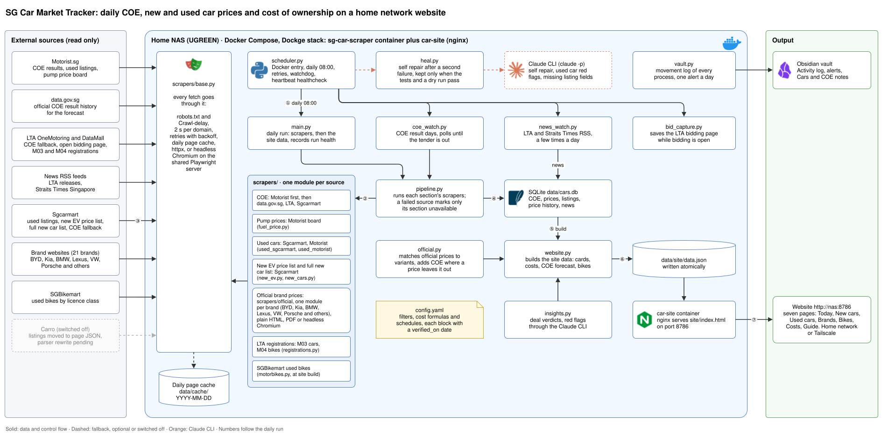

# SG Car Market Tracker

A self hosted Docker service that scrapes the Singapore car market every morning (COE results, used car listings, new EV prices, pump prices, top selling brands), filters and ranks the cars against your criteria, works out the real cost of ownership, and publishes it all on a small website on the home network.




<sub>Editable source: [`docs/architecture.drawio`](docs/architecture.drawio). PNG fallback: [`docs/architecture.png`](docs/architecture.png).</sub>

## The website

The website is the tracker's only output. The `car-site` nginx container serves it on port 8786
(`site/index.html`, data in `data/site/data.json`). `main.py` rewrites the data after every daily run through
`website.py`, `coe_watch.py` rewrites it on COE result days as soon as the new tender is out, and
`python website.py` rebuilds it from the database at any time. It has seven pages:

* **Today**: COE result, trend and forecast for every category, LTA news that affects car buyers, the three cheapest cars to own, the best used car deals, pump prices and the biggest used car price cuts.
* **New cars**: every new car on Sgcarmart's price list, electric, hybrid and petrol, filtered by fuel, body type, budget, COE category and brand, as cards or a table. Each car shows deposit, monthly instalment, cost a year and the price at the next COE.
* **Used cars**: every live listing the tracker follows, with the shortlist filters as a toggle, price history and the reason a car is not shortlisted.
* **Brands**: LTA registrations by brand, with each EV brand's line up.
* **Bikes**: used bikes by licence class and the top selling bike brands.
* **Costs**: the cost of ownership comparison for any car on the site.
* **Guide**: the rules behind the numbers (loan limits, ARF and PARF, EV incentives).

The full new car list comes from Sgcarmart's listing pages (`scrapers/new_cars.py`, about 38 pages at the site's 30 second crawl delay, once a day). Body types come from `new_ev.body_type_overrides` in `config.yaml`. LTA news comes from `news_watch.py`, which reads LTA's RSS feed a few times a day and keeps the releases that match `news.keywords`.

## Why this exists

Buying a car in Singapore means tracking a COE price that moves every two weeks, used listings spread over several portals, and a cost model (ARF, PARF rebate, road tax bands, VES and EEAI rebates, MAS loan limits) that no listing site shows in one place. Checking all of that by hand every day is tedious. This service does it once a day on a home NAS and puts every car, ranked and costed, on one website with a link to each listing.

## Highlights

| Decision | Trade off and where it lives |
|---|---|
| **Polite scraping by construction.** Every fetch goes through one base class that checks `robots.txt`, honours a site's `Crawl-delay` when it is longer than our own 2 s per domain gap, retries with exponential backoff, and caches each page per day. | A full run takes about an hour because Sgcarmart asks for 30 s between requests. Accepted: slow and allowed beats fast and blocked. `scrapers/base.py` |
| **Label based parsers instead of CSS selectors.** Fields are found by their visible labels ("Mileage", "COE", "OMV") and number patterns. | Survives most cosmetic redesigns. Structural changes still break it, so every parser has a saved HTML fixture and a test. `scrapers/parse_utils.py`, `fixtures/` |
| **LLM as a bounded fallback, not a dependency.** When a listing page loses required fields, the page text goes to `claude -p` with no tools, no session, trimmed input and a hard cap of 20 calls per run. | Keeps the data flowing through a layout change while the parser is fixed. If the CLI is missing or fails, the run carries on without it. `ai.py`, `config.yaml` `ai` |
| **Idempotent reruns.** Upserts into SQLite and a daily page cache under `data/cache/YYYY-MM-DD/`. The site data is written atomically (temp file, then rename). | A crash or manual rerun on the same day never duplicates rows, and nginx never serves a half written file. `--force` ignores the cache. `db.py`, `website.py` |
| **Failure isolation per source.** Each scraper failure marks its section unavailable and the run continues. COE sources are tried in order (Motorist, then LTA, then Sgcarmart). | One broken site never kills the whole run; the site shows the last good data. `pipeline.py` |
| **All assumptions in config, each with a `verified_on` date.** Filters, road tax bands, PARF schedules, ARF tiers, loan rules, insurance bands. | Policy changes (for example the February 2026 PARF cut) are a YAML edit, not a code change, and staleness is visible. `config.yaml`, `costs.py` |

## How it works

1. **Trigger.** `scheduler.py` runs `main.py` daily at `general.schedule_time` (08:00 SGT) as a supervised child process, with retries and self repair (see "Staying up without anyone watching"). On COE result days it also starts `coe_watch.py`, and a few times a day `news_watch.py`.
2. **Fetch.** Scrapers pull from Motorist, Sgcarmart, the brands' own websites and LTA through `BaseScraper` (httpx, or Playwright Chromium for rendered pages), with robots.txt checks, throttling, retries and the daily cache.
3. **Parse.** Label based parsers turn pages into pydantic models (`models.py`). Missing required fields optionally go to the Claude CLI fallback.
4. **Store.** `pipeline.py` runs the scrapers and `db.py` upserts COE results, new EV and new car prices, official prices, used listings with price history, and fuel prices into `data/cars.db`, and marks listings that disappeared. The run's health (which sections failed) goes into the database for the scheduler.
5. **Filter and cost.** `filters.py` applies the hard filters (price ceiling, mileage per year, owners, COE years left, flag words) and ranks by brand sales, then value. `costs.py` computes road tax, depreciation, PARF, energy, insurance band, deposit and instalment. `insights.py` adds deal verdicts and red flags.
6. **Build.** `website.py` turns the database into `data/site/data.json`: every car as a card with its costs, the COE block with forecast, brands, bikes, fuel and news.
7. **Serve.** The `car-site` nginx container serves `site/index.html`, which reads the data file in the browser.

## Tech stack

| Layer | Tech |
|---|---|
| Language | Python 3.11+, managed with `uv` |
| Scraping | httpx, Playwright (Chromium), selectolax, tenacity, pypdf (LTA M03 registrations PDF) |
| Models and config | pydantic v2, PyYAML, python-dotenv |
| Storage | SQLite (`data/cars.db`) |
| Output | Static website (`site/index.html` plus `data/site/data.json`) on nginx |
| Optional AI | Claude Code CLI in print mode (`claude -p`) |
| Runtime | Docker Compose on a UGREEN NAS (Dockge stack), image based on `mcr.microsoft.com/playwright/python` |
| Tests | pytest, fixture pages, a local fixture web server for end to end |

## Getting started

### Prerequisites

* Python 3.11+ and [uv](https://docs.astral.sh/uv/) (or plain `pip install -r requirements.txt`)
* Chromium for Playwright: `uv run playwright install chromium`

### Configure

```bash
cp .env.example .env
```

| Key | Required | Purpose |
|---|---|---|
| `SCRAPER_CONTACT` | no | Added to the User Agent so site owners can reach you |
| `CLAUDE_CODE_OAUTH_TOKEN` or `ANTHROPIC_API_KEY` | no | Only if you use the `ai` block and do not sign in interactively |
| `VAULT_HOST_DIR` | no | Host folder of the Obsidian vault the tracker writes its movement log to |

Never commit `.env`. Filters, searches and cost assumptions live in `config.yaml`.

### Run locally

```bash
uv sync
uv run python main.py --dry-run            # scrape everything and record the run's health, leave the site alone
uv run python main.py --section coe --dry-run
uv run python main.py                      # scrape, store and rewrite data/site/data.json
uv run python main.py --force              # ignore today's page cache
uv run python website.py                   # rebuild the site data from the database, no new scraping
```

`main.py` exits 0 on success and 2 when the site data could not be written. Open `site/index.html` through any
static server with `data/site/` mounted at `live/` (see `docker-compose.yml`), or run the compose stack.

### Deploy on a NAS with Docker

```bash
docker compose up -d --build
docker compose logs -f
```

* The website is at `http://<nas>:8786` on the home network or over Tailscale.
* `RUN_ON_START` is `"0"`: a full crawl takes about two hours, and the scheduler already catches up a day it missed while the container was down. Set it to `"1"` to run the full scrape as soon as the container starts.
* The project folder is bind mounted at `/app`, so a code or config update is copy the files and restart. A `requirements.txt` change needs a rebuild (`pull_policy: build` does that on every `up`).
* `mem_limit: 2g` and `shm_size: 512m` cap Chromium and a self repair so a runaway page cannot starve the NAS. The image is about 2 GB because of Chromium.
* Optional Claude CLI sign in, stored in `data/claude/` on the host so it survives rebuilds:

  ```bash
  docker compose exec -it sg-car-scraper claude auth login
  ```

### Staying up without anyone watching

`scheduler.py` supervises everything, with limits in the `resilience` and `self_heal` blocks of `config.yaml`:

* **Child processes with time limits.** Each daily run is its own process and is stopped after `max_run_minutes`, together with any Chromium it started, so a hung page cannot freeze the service.
* **Retries.** A run that crashes, cannot write the site data or leaves sections unavailable is tried again after `retry_after_minutes`, up to `max_retries_per_day`.
* **Self repair.** When a run fails a second time for a reason other than the site data write (exit code 2), `heal.py` asks the Claude CLI (`claude -p`) to fix the code. Claude may only edit `scrapers/`, add files under `fixtures/` and `tests/`, and run the tests or a dry run. It cannot use git and is capped by `max_turns` and `max_budget_usd`. The change is kept only when it stays inside those folders, the tests pass and the failed sections recover on a dry run. Otherwise every file is put back. Each attempt is saved under `data/self_heal/`, logged to `logs/heal.log` and noted in the vault. A kept change exists only on the NAS: see it with `git diff`, and stash or commit it before the next `git pull`.
* **One alert.** If the run still fails after every retry and repair, one alert a day says what is wrong. It goes to the vault's Activity log and to the database (`sent_state` key `last_alert`).
* **Heartbeat and watchdog.** The loop writes `data/heartbeat` every tick. Docker's healthcheck (`python scheduler.py --health`) reads it, and a watchdog exits the process if the loop stalls, so `restart: unless-stopped` brings it back. `init: true` reaps finished child processes.
* **Catch up and housekeeping.** A run missed while the container was down happens on start. Once a day, page cache folders and repair records past their keep days are removed, and log files rotate at `log_max_mb`.

Self repair needs the Claude CLI signed in inside the container (see above). A rehearsal against a deliberately broken COE parser was fixed and kept for $0.17.

It runs only on the NAS. The GitHub Actions copy of the daily crawl was removed on 2026-10-17, so the sites are not crawled twice.

## Project structure

```
main.py, scheduler.py       CLI entry point and the supervisor used in the container
heal.py                     self repair through claude -p, kept only when safe and working
pipeline.py                 runs the scrapers of a section and stores the results
website.py, site/           builds data/site/data.json, and the page that shows it
coe_watch.py, news_watch.py COE result day site update, LTA news for the site
filters.py, costs.py        used car filters and ranking, cost of ownership engine
insights.py, official.py    deal verdicts and red flags, brand website prices
db.py, models.py            SQLite schema and upserts, pydantic records
vault.py                    Obsidian movement log (Activity, Cars, COE notes)
ai.py                       bounded Claude CLI helper (field fallback, red flags)
scrapers/                   base.py (robots, throttle, retry, cache) plus one module per source
config.yaml                 every filter, formula and assumption, with verified_on dates
fixtures/                   saved HTML pages, including live captures, used by parser tests
tests/                      pytest suite
docs/                       architecture diagram and the Obsidian vault (docs/vault/)
```

## Testing and quality

```bash
uv run pytest
```

The suite covers:

* every parser against a fixture in `fixtures/` (hand built and live captures)
* every filter and every cost formula with known inputs, and the next tender date calculation
* the website data builder and the news list
* database upserts, the scheduler, retries, alerts and self repair
* `tests/test_e2e.py`: the whole program end to end, with a local web server serving fixtures under each site's URL patterns and Chromium rendering, down to the `data/site/data.json` it writes.

### When a site changes layout

1. Save the live page into `fixtures/<site>_<kind>.html` (today's copy is already in `data/cache/YYYY-MM-DD/`).
2. Run `uv run pytest tests/test_<scraper>.py`. The failing assertion names the field that stopped parsing.
3. Fix the parser, usually a new label synonym or link pattern, then run the full suite and a dry run.

On the NAS, self repair tries these steps on its own after a second failed run. When it keeps a change, bring it into the repository from `git diff` in the project folder.

## Design decisions and limitations

* **Carro is switched off.** Its fuel filter stopped filtering in 2026 and listings now sit in escaped page JSON. The old parser and fixtures remain; the search URLs are commented out in `config.yaml` until the JSON parser is written.
* **Cnergy no longer publishes prices online.** The run logs it instead of reporting a daily failure. Pump prices come from Motorist's grade board.
* **Parsers need upkeep.** Many fixtures were first written by hand before the sites could be reached. COE, Motorist and the Sgcarmart used and new EV parsers have since been reworked against live pages, but expect periodic parser maintenance as sites change.
* **Slow by design.** Sgcarmart's 30 s Crawl-delay makes a full run take one to two hours. Move `schedule_time` earlier if the site updates too late.
* **New EV range is estimated** as battery kWh times km per kWh. Claimed WLTP figures can be added in `config.yaml`.
* **Insurance bands are indicative**, and tender dates shifted by public holidays are not modelled.
* **Without a Claude CLI login** every run spends its 20 call budget on failures. Sign in or set `ai.enabled: false`.
* **Terms of use.** COE and fuel pages are public and low volume. Sgcarmart, Carro and Motorist are commercial classifieds whose terms likely restrict automated access, so this is a personal, low volume tool that honours `robots.txt` and never bypasses CAPTCHAs, anti bot measures or logins. LTA's data.gov.sg COE dataset is a scraping free alternative for COE. Remove any source from `config.yaml` if its owner objects.

Policy figures (road tax formula, PARF schedules including the February 2026 change, ARF tiers, LTV limits, VES and EEAI) were checked on 2026-09-29 and are dated in `config.yaml`.

---

<OWNER> · [GitHub](https://github.com/gcjk768)
